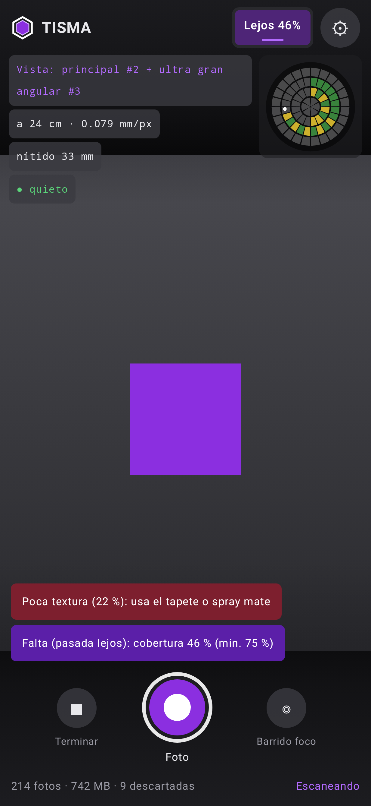

# Tisma Scanner

App Android para **escanear piezas en 3D por fotogrametría**. Combina:

- **Todas las cámaras posibles a la vez**: los objetivos físicos de la cámara lógica trasera
  (principal, ultra gran angular, tele/macro) y las cámaras concurrentes (frontal + trasera).
  Si el móvil no deja abrirlas a la vez, hay un **modo rotativo** que pasa por todas en cada disparo.
- **INS (sistema de navegación inercial)**: acelerómetro + giróscopo + magnetómetro con filtro de
  Mahony, integración strapdown y **ZUPT**. Decide cuándo disparar (cobertura sin fotos
  redundantes y sin fotos movidas) y da la pose aproximada de cada foto.
- **GPS** fusionado con la INS (Kalman débilmente acoplado) y registrado para georreferenciar.
- **HDR**: horquillado −2/0/+2 EV con exposición manual cuando el móvil está quieto; se fusiona en el PC.
- **Profundidad por enfoque**: barrido del objetivo de cerca a lejos para saber qué está delante y
  qué detrás en la misma escena, y obtener una imagen totalmente enfocada.
- **Modo calidad para superficies planas/opacas**: reducción de ruido y realce de bordes al mínimo,
  linterna, bloqueo de foco/exposición/balance, tapete imprimible con textura + marcadores ArUco.

- **Cobertura y calidad en vivo**: una cúpula muestra qué ángulos de la pieza ya están
  fotografiados y hacia dónde apunta la cámara. Cada foto se analiza (nitidez, textura,
  exposición), y la app solo dice **"Listo para enviar"** cuando el escaneo merece el cómputo.

- **Pasadas lejos + cerca**: *Lejos* = vista de la **principal** + la **ultra gran angular**
  disparando a la vez (geometría global, HDR). *Cerca* = la **principal** apilando enfoques (detalle).
  La **macro** es opcional (Ajustes → Cámaras): si se activa, *Cerca* muestra sólo la macro y la
  principal dispara a la vez. La app detecta el papel de cada objetivo, también los ocultos (en
  el Honor los encuentra probando su número), y los combina de la mejor forma que permita el
  móvil: flujos físicos sincronizados por hardware → cámaras concurrentes → por turnos.
- **Distancia medida con el enfoque (activado por defecto)**: cada 6 disparos, con el móvil
  quieto, la app barre el enfoque de 0,7× a 1,4× la distancia a la pieza. En el servidor eso da un
  mapa de profundidad en mm por cada barrido y una **escala métrica sin tapete**, comparando la
  profundidad medida por enfoque con la de la fotogrametría en cada punto. Las fuentes de escala
  se muestran juntas para contrastarlas: tapete ArUco > enfoque > INS.
- **Postprocesado completo en el servidor**:
  - *Imágenes*: exposición y color iguales en todas las fotos; para detectar puntos, ruido
    quitado sólo si hace falta y **filtro de Wallis** (2-4,6× más emparejamientos que CLAHE en
    superficies lisas, medido).
  - *INS*: quita del modelo las fotos que la fotogrametría registró mal (su giro contradice
    al giróscopo) y aporta la gravedad para orientar la pieza.
  - *Nube y malla* (`tools/postprocess.py`): limpieza, quita la mesa (con la gravedad, para no
    confundirla con una cara plana de la pieza), aísla la pieza, base plana, malla cerrada y
    **STL en mm listo para imprimir** con informe de medidas, volumen y desviación. En una prueba
    sintética: 40,23 × 30,23 × 20,31 mm frente a los 40 × 30 × 20 reales, volumen +0,2 %.
- **Descarte de fotos movidas en el propio móvil**: giro medido por el giróscopo durante la exposición
  (> 1,5 px de arrastre), más nitidez relativa. Así no se guardan ni se suben. **JPEG ajustable**
  (92 por defecto) y una herramienta para medir cuánto se puede comprimir sin perder calidad.

- **Estabilización por software**: la vista previa se estabiliza con el giróscopo (orientación en el
  instante exacto de cada fotograma, recorte del 15 % sólo en pantalla). Para las fotos, la
  **ráfaga anti-movimiento** toma 4 fotos con 1/4 de exposición, menos arrastre en cada una, y el
  servidor las alinea con la más nítida y las promedia: menos movimiento sin más ruido. Las fotos
  no se recortan, para que la calibración de la cámara sea la misma en todas.
- **Precisión de la INS medible**: prueba de quietud en la app (ruido, sesgo, deriva) y
  `tools/ins_accuracy.py`, que mide el error real en movimiento contra las poses de la
  fotogrametría. Incluye ZARU y suavizado entre paradas.



La reconstrucción 3D se hace en el PC (COLMAP + OpenMVS) con los scripts de `tools/`. El móvil se
dedica a capturar los datos más ricos y mejor sincronizados posibles.

## Compilar e instalar

Requisitos: Android Studio (o JDK 17+ y Android SDK 35).

```bash
./gradlew :app:assembleDebug
adb install -r app/build/outputs/apk/debug/app-debug.apk
./gradlew :app:testDebugUnitTest    # tests de la INS
```

minSdk 30 (Android 11). Permisos: cámara, ubicación precisa y muestreo alto de sensores.

## Primera prueba en el Honor Magic 6 Lite

El Magic 6 Lite tiene una trasera de 108 MP (principal), una de 5 MP (ultra gran angular) y una
de 2 MP (macro), además de la frontal de 16 MP. Algo a tener en cuenta:

1. Abre la app y mira la sección **"Cámaras detectadas"**. Ahí ves qué expone Honor a las apps de
   terceros. Muchos fabricantes **ocultan** la ultra gran angular y la macro (solo las usa su app de
   cámara). Si sale una cámara "lógica[...]" con varios IDs, la app tomará fotos simultáneas de todos.
2. Mira **"Flujos abiertos"** para ver con qué resolución se ha abierto cada cámara. La app prueba
   primero la resolución máxima y baja si el driver la rechaza. El sensor de 108 MP suele entregar
   12 MP (binning) a apps de terceros.
3. Si "Cámaras concurrentes" sale como *no soportado*, activa **"Rotar por todas las cámaras"**.
   En cada disparo abre cada cámara por turnos (~1 s por cámara), así que hay que quedarse quieto.
4. Si la cámara reporta "(sin control manual)" en el registro, el HDR y el barrido de foco se
   desactivan automáticamente para esa cámara (la foto normal sigue funcionando).

## Cómo escanear (sobre todo piezas planas / opacas)

La fotogrametría encuentra la posición de la cámara emparejando puntos entre fotos. Una superficie
lisa, mate y de un solo color **no tiene puntos**. Esto es lo que más influye en la calidad, de más a menos:

1. **Pon la pieza sobre el tapete** (`python3 tools/make_scan_mat.py --paper a4`). Imprímelo al 100 %
   y comprueba con una regla que la barra mide 100 mm. El tapete localiza la cámara aunque la pieza
   no tenga textura, y sus marcadores dan la **escala real en mm**.
2. **Si la pieza es lisa, dale textura**: spray de escaneo matificante (se evapora en unas horas),
   polvo de talco, o puntos con rotulador si no importa marcarla. Si es brillante, el spray es obligatorio.
3. **Luz difusa y constante**: día nublado, caja de luz o dos lámparas con difusor. La linterna
   del móvil ayuda a corta distancia pero crea reflejos en piezas satinadas.
4. **Bloqueo de foco/exposición activado** (por defecto). Enfoca la pieza **antes** de pulsar Iniciar.
   Si el foco cambia, cambian los intrínsecos de la cámara y se pierde precisión.
5. **Movimiento**: rodea la pieza en 2-3 alturas (unos 30°, 50° y 70° sobre la mesa), con un
   solape grande. El disparo automático salta cada ~8° de giro. Si aparece "¡DEMASIADO RÁPIDO!",
   ve más despacio. Párate un instante de vez en cuando: así la INS se recalibra (ZUPT) y se hace el HDR.
6. **Dos pasadas.** Arriba a la derecha elige **Lejos**: la pieza entera en el encuadre, a 2-3 veces
   su tamaño. Rodéala hasta que esté "Listo". Después elige **Cerca**: acércate 2-3 veces más,
   indica la profundidad de la pieza y repasa las zonas con detalle. Al cambiar de pasada, la app
   vuelve a enfocar y bloquea el foco: cada distancia tiene su propia calibración.
   No te acerques más de 3 veces de golpe respecto a la pasada lejana: si la escala cambia mucho,
   las fotos de cerca no se emparejan con las de lejos.
7. **Mira la cúpula** (abajo a la derecha de la vista previa). El centro es la vista desde arriba
   y el borde, las vistas rasantes. Gris = falta, amarillo = 1 foto, verde = 2 o más. El punto
   blanco es hacia dónde apuntas ahora; "arriba" en el dibujo es donde empezaste. Debajo aparecen
   avisos del tipo *"A 10–30° de altura: falta el sector 90°–150°"*.
   Si sale **"⚠ Poca textura"**, la pieza no tiene puntos que emparejar: pon el tapete o usa spray.
8. **Barrido de foco**: con el móvil apoyado y quieto, pulsa "Barrido foco" en las zonas con relieve.
9. Cuando ponga **"✓ Listo para enviar"** (≥ 75 % de cobertura, ≥ 40 fotos y < 20 % movidas),
   pulsa **Detener** y **Compartir** para mandar el `.zip` al PC (o `adb pull` desde
   `Android/data/com.tisma.scanner/files/scans/`).

## Reconstrucción en el PC

```bash
pip install opencv-contrib-python numpy
# COLMAP: https://colmap.github.io/install.html   OpenMVS (opcional): https://github.com/cdcseacave/openMVS

python3 tools/reconstruct.py scan_20261102_101500.zip --work out --mat tapete.json --dense openmvs
python3 tools/depth_from_focus.py out/raw/scan_20261102_101500 --out out/dff
```

Para decidir la compresión con tus propias fotos:
`python3 tools/compression_test.py out/raw/scan_xxx` muestra MB por foto y cuántos emparejamientos
se conservan con JPEG 95/92/90/85/80/70, WebP y AVIF. Elige el nivel más comprimido que mantenga
≥ 95 % de los emparejamientos. En pruebas sintéticas incluso JPEG 85 lo cumplía, pero la
microtextura real es más delicada: mídelo.

`reconstruct.py` hace lo siguiente:
0. Une cada **apilado de enfoque** en una sola imagen totalmente enfocada (y guarda su mapa de profundidad).
1. Descarta las fotos que la app marcó como movidas y fusiona las ráfagas HDR (Mertens).
2. Aplica CLAHE (realce de microtextura) **solo** a las imágenes que se usan para detectar puntos.
3. Lanza COLMAP con una cámara por objetivo **y por distancia de enfoque** y los intrínsecos de fábrica del móvil como punto de
   partida. Usa SIFT con DSP + forma afín, que funciona mejor con poca textura.
4. Pone el modelo en **metros**: con los marcadores ArUco si los hay (error ~0,1 %); si no, alineando
   la trayectoria con la de la INS (error ~5-10 %).
5. Densifica y genera la malla texturizada (OpenMVS, o COLMAP si tienes CUDA).

## Formato del escaneo

```
scan_YYYYMMDD_HHMMSS/
  session.json         dispositivo, cámaras (intrínsecos, distorsión, pose entre objetivos, foco), ajustes
  imu.csv              todas las muestras crudas de los sensores (accel, gyro, mag, sin calibrar, rotación, presión)
  gps.csv              fixes GNSS/fused con precisión
  ins_trajectory.csv   trayectoria de la INS (pos, vel, orientación, reposo)
  frames.csv           una fila por foto: cámara, timestamp, pose INS interpolada a ese instante
  quality.csv          por foto: nitidez, textura, recorte, movida sí/no, ángulo de vista, sector de cobertura
  quality_summary.json cobertura total y por anillo, fotos movidas, avisos y si está "listo"
  capture_meta.jsonl   por foto: exposición, ISO, foco (dioptrías), EV del HDR, intrínsecos dinámicos
  images/<camera_id>/<t_ns>.jpg   JPEG en la orientación nativa del sensor (sin rotar)
```

Todos los timestamps están en `elapsedRealtimeNanos`, así que fotos, IMU y GPS están en la misma
base de tiempo. Si la cámara no la usa, la app la corrige.

## Lo que se puede esperar (realista)

| Fuente | Qué aporta | Precisión típica |
|---|---|---|
| Fotogrametría + tapete ArUco | forma y escala de la pieza | 0,1-0,5 mm a 20-40 cm, si hay textura |
| INS (IMU de móvil) | orientación muy buena; posición solo unos segundos | posición: cm tras ~2 s sin pararse |
| GPS | georreferencia, deriva en escaneos grandes | 2-5 m (no sirve para la forma de piezas pequeñas) |
| Profundidad por enfoque | qué está delante/detrás; mapa de profundidad aproximado | mm-cm cerca, según la calibración del foco |
| HDR | detalle en zonas oscuras y brillantes | — |

La INS y el GPS **no sustituyen** a la fotogrametría. Dan a cada foto una pose inicial, la escala
de respaldo y la decisión de cuándo disparar.

## Estructura del código

```
app/src/main/java/com/tisma/scanner/
  camera/CameraInventory.kt        enumera cámaras lógicas/físicas y su calibración
  camera/RigPlanner.kt             decide qué cámaras abrir a la vez
  camera/MultiCameraController.kt  Camera2: flujos simultáneos, HDR, barrido de foco, ajustes de calidad
  sensors/ImuRecorder.kt           IMU a máxima frecuencia → INS + CSV
  sensors/GpsRecorder.kt           GNSS → INS + CSV
  ins/MahonyFilter.kt              orientación (ganancia adaptativa)
  ins/StrapdownIns.kt              navegación inercial + ZUPT + corrección GNSS
  ins/KeyframeSelector.kt          disparo automático guiado por la INS
  camera/Optics.kt                 profundidad de campo, mm/px, planos del apilado de enfoque
  camera/ScanPass.kt               pasadas lejos/cerca y qué cámaras usa cada una
  quality/CoverageMap.kt           cúpula de cobertura a partir de la orientación INS
  quality/ImageQuality.kt          nitidez normalizada, textura por baldosas, recorte
  session/ScanSession.kt           escritura del dataset y .zip
  ui/                              Compose con el estilo de TISMA: vista previa, cúpula, avisos, ajustes
tools/
  make_scan_mat.py                 tapete imprimible con textura + ArUco
  reconstruct.py                   HDR → COLMAP → escala métrica → malla
  depth_from_focus.py              mapas de profundidad a partir de barridos de foco
  compression_test.py              cuánto comprimir sin perder emparejamientos
  ins_accuracy.py                  error real de la INS frente a la fotogrametría (+ suavizado ZUPT)
  postprocess.py                   nube densa -> pieza limpia, cerrada, en mm (STL) + informe
```

## Próximos pasos posibles

- Captura RAW/DNG (más rango dinámico y sin procesado) si el móvil lo permite.
- Usar la distancia entre objetivos (`pose_translation_m`) como restricción de rig en COLMAP.
- Reconstrucción preliminar en el propio móvil para revisar el escaneo antes de irse.
